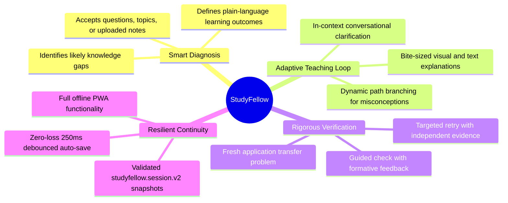
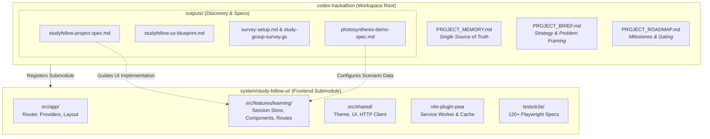
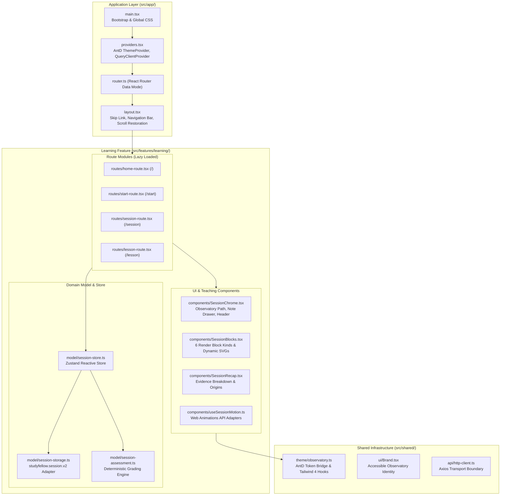
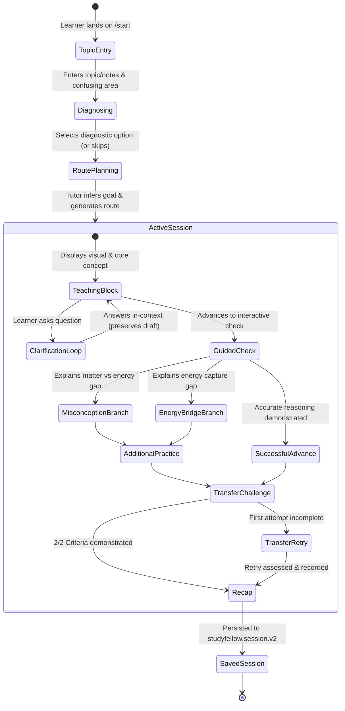
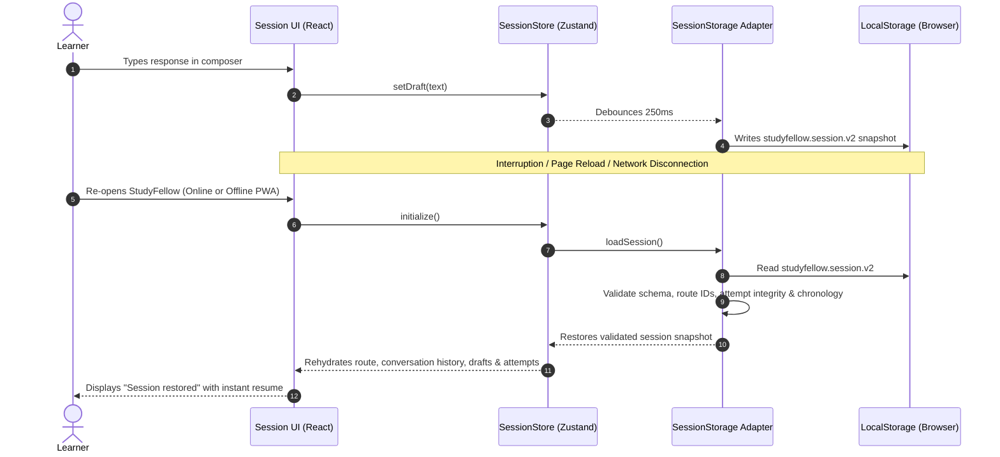

# StudyFellow — Codex Hackathon

[](file:///Users/user/Desktop/apps/learn/codex-hackathon/system/study-fellow-ui/package.json)
[](file:///Users/user/Desktop/apps/learn/codex-hackathon/system/study-fellow-ui/package.json)
[](file:///Users/user/Desktop/apps/learn/codex-hackathon/system/study-fellow-ui/tests/e2e)
[](file:///Users/user/Desktop/apps/learn/codex-hackathon/system/study-fellow-ui/vite.config.ts)

**StudyFellow is an AI teaching fellow designed to help learners make steady, uninterrupted progress through difficult concepts and coursework.**

Instead of acting as a passive search engine or generating lengthy text walls, StudyFellow transforms a learner's raw topic, question, or uploaded study notes into an interactive, structured, and source-grounded learning session. It diagnoses knowledge gaps, plans a tailored learning route, teaches through bite-sized interactive steps with visual aids, answers clarifications in context, adapts explanations dynamically, verifies understanding through a fresh transfer challenge, and guarantees seamless offline session recovery.

---

## Table of Contents

1. [Hackathon Submission & Track Alignment](#hackathon-submission--track-alignment)
2. [Product Vision & Core Pillars](#product-vision--core-pillars)
3. [System Architecture](#system-architecture)
   - [High-Level Topology](#high-level-topology)
   - [Frontend Architecture & Component Hierarchy](#frontend-architecture--component-hierarchy)
   - [Adaptive Teaching State Machine](#adaptive-teaching-state-machine)
   - [Session Continuity & Storage Contract](#session-continuity--storage-contract)
4. [Cosmic Observatory Design System](#cosmic-observatory-design-system)
5. [Repository Structure](#repository-structure)
6. [Getting Started & Local Development](#getting-started--local-development)
7. [Testing, Quality Assurance & Verification](#testing-quality-assurance--verification)
8. [Feature Verification Matrix](#feature-verification-matrix)
9. [Project Governance & Memory](#project-governance--memory)

---

## Hackathon Submission & Track Alignment

### Codex Hackathon 2026 Profile

| Dimension | Details |
| :--- | :--- |
| **Project Name** | **StudyFellow** (formerly *comeTeachMe*) |
| **Submission Window** | October 12 – October 16, 2026 |
| **Primary Track** | **Engagement & Staying in the Learning Journey** — Reducing startup friction, preventing cognitive overload, offering conversational unblocking, and enabling resilient session resumption. |
| **Supporting Track** | **Access & Discovery of Learning Resources** — Unlocking existing syllabus materials, textbooks, and notes into active, guided instruction. |
| **Target Audience** | Secondary-school students, college undergraduates, and professional learners struggling with complex concepts. |
| **Primary Market Hypothesis** | Emerging markets with intermittent connectivity and mobile-first learners, starting in Africa (Nigeria). |
| **Hackathon Fixture** | Secondary-school biology: **Photosynthesis** (Energy vs. Matter inputs, Chlorophyll capture, and Limiting Factors), grounded in [OpenStax Biology 2e](https://openstax.org/books/biology-2e/pages/8-1-overview-of-photosynthesis). |

### Judging Rubric Mapping

- **Uniqueness (25%)**: Bidirectional conversational tutoring with in-context clarification, deterministic multi-path adaptation, and provenance-retaining answer assessment.
- **Scalability across Geographies (25%)**: Zero-backend server overhead for client evaluation, offline PWA service worker caching, lightweight inline SVG graphics, and optimized mobile rendering down to 320px screens.
- **Codex Usage (25%)**: Structured architectural workflows, automated E2E verification suites, typed domain contracts, and end-to-end evidence pipelines documented in project records.
- **Presentation (25%)**: Production-ready *Cosmic Observatory* design system with WCAG AAA/AA accessible contrast, fluid Web Animations API micro-interactions, and comprehensive walkthrough rehearsal tests.

---

## Product Vision & Core Pillars



1. **One-on-One Conversational Fellowship**: Learners do not need to create rigid schedules upfront. They bring a topic or assignment, attach notes, and receive an AI-inferred learning route.
2. **Contextual Clarification**: When learners get stuck, they ask questions directly within the current step. The assistant resolves their confusion in context without discarding their place or draft answers.
3. **Evidence-Based Adaptation**: Feedback distinguishes matter from energy inputs. Misconceptions trigger targeted bridge steps rather than generic repetitions.
4. **Resilient Local-First Continuity**: All drafts, message histories, route states, and immutable attempts survive browser reloads, interruptions, and offline conditions.

---

## System Architecture

StudyFellow is engineered with a modular, decoupled architecture separating product specifications, research pipelines, and a client-side reactive frontend single-page application.

### High-Level Topology



---

### Frontend Architecture & Component Hierarchy

The frontend application in [`system/study-fellow-ui`](file:///Users/user/Desktop/apps/learn/codex-hackathon/system/study-fellow-ui) follows a strict unidirectional dependency rule:
`app` $\rightarrow$ `features` $\rightarrow$ `shared`.



---

### Adaptive Teaching State Machine

StudyFellow models the one-on-one session as an interactive state machine that responds to learner reasoning:



---

### Session Continuity & Storage Contract

To ensure that learners never lose their progress during interruptions, power loss, or network dropouts, StudyFellow implements a strict persistence protocol:



---

## Cosmic Observatory Design System

StudyFellow's visual identity, **Cosmic Observatory**, embodies scholarship, calm focus, and intellectual discovery:

- **Palette**: Midnight Navy (`#0b1528`), Ivory Reading Surface (`#faf8f5`), Celestial Gold (`#d4a373`), Deep Orbital Indigo (`#1e293b`), and Accessible Focus Blue (`#1d4ed8`).
- **Typography**: Editorial local Serif stack for lesson headers and scientific titles; high-legibility System Sans-Serif (`Inter`, `system-ui`) for interaction controls and body reading.
- **Accessibility & Contrast**: Built to exceed WCAG 2.1 AA/AAA standards with high-contrast text and placeholder styling (~6.14:1 contrast ratio).
- **Responsible Motion**: Subtle, interruptible transitions built via the native Web Animations API, fully respecting `prefers-reduced-motion` settings.

---

## Repository Structure

```text
codex-hackathon/
├── .env.example                       # Environment template
├── AGENTS.md                          # Repository instructions & agent guidance
├── PROJECT_BRIEF.md                   # Market analysis, audience & product brief
├── PROJECT_MEMORY.md                  # Authoritative log of project facts & milestones
├── PROJECT_ROADMAP.md                 # Hackathon roadmap & delivery stages
├── outputs/                           # User research, surveys & specifications
│   ├── photosynthesis-demo-spec.md    # Canonical lesson specification (OpenStax 2e)
│   ├── studyfellow-project-spec.md    # Detailed functional & acceptance requirements
│   ├── studyfellow-ux-blueprint.md    # Interaction flow & UX wireframes
│   ├── survey-setup.md                # Learner discovery survey methodology
│   └── study-group-survey.gs          # Google Apps Script survey automation
│
└── system/study-fellow-ui/            # [Git Submodule] Frontend React Application
    ├── package.json                   # UI package dependencies & scripts
    ├── vite.config.ts                 # Vite bundler & PWA plugin configuration
    ├── docs/
    │   └── architecture.md            # Comprehensive frontend architecture documentation
    ├── plans/                         # Phase 0–4 technical specifications & review records
    ├── src/
    │   ├── main.tsx                   # Browser bootstrap
    │   ├── index.css                  # Canonical Tailwind 4 design tokens
    │   ├── app/                       # Application layout, router & query providers
    │   ├── features/learning/         # Learning domain routes, store, components & scenario
    │   └── shared/                    # Cosmic Observatory theme, brand & HTTP client
    └── tests/e2e/                     # Playwright end-to-end regression test suite
```

---

## Getting Started & Local Development

### Prerequisites

- [Bun](https://bun.sh/) (recommended runtime & package manager) $\ge 1.1.0$ or [Node.js](https://nodejs.org/) $\ge 20.0.0$
- [Git](https://git-scm.com/) $\ge 2.30$

### Setup & Installation

1. **Clone the repository with submodules**:
   ```bash
   git clone --recurse-submodules https://github.com/myckhel/codex-hackathon-study-felow.git
   cd codex-hackathon
   ```
   *(If you already cloned without submodules, initialize them via: `git submodule update --init --recursive`)*

2. **Navigate to the UI submodule**:
   ```bash
   cd system/study-fellow-ui
   ```

3. **Install dependencies**:
   ```bash
   bun install
   ```

4. **Launch the local development server**:
   ```bash
   bun run dev
   ```
   Open [http://localhost:5173](http://localhost:5173) in your browser.

---

## Testing, Quality Assurance & Verification

StudyFellow features a comprehensive automated testing pipeline ensuring that every user interaction, state adaptation, and persistence requirement is validated across desktop and mobile viewports:

```bash
# Run full Playwright E2E test suite (desktop + mobile)
bun run test:e2e

# Run tests in interactive UI mode
bun run test:e2e:ui

# Verify type safety and create production bundle
bun run build

# Run linting across TypeScript and React code
bun run lint

# Verify PWA offline cached reload and resume
PLAYWRIGHT_PRODUCTION=1 bun run test:e2e --grep "production cached"
```

### Automated Rehearsal & Verification Metrics

- **E2E Test Suite**: **120+ passed tests** covering all 3 learning paths (Ready, Misconception, Clarification), keyboard navigation, screen reader accessibility, and reset flows.
- **Bundle Efficiency**: Minified main JS $\approx 650.78\text{ kB}$, total app assets $\approx 740.61\text{ kB}$ (a 7.08% reduction from initial baseline).
- **PWA Precache Footprint**: 748.78 KiB precached for instant offline loading.
- **Zero Page Errors**: 0 unhandled exceptions or runtime console errors across automated 210-second paced rehearsal runs.

---

## Feature Verification Matrix

To ensure rigorous transparency for judges and contributors, the capabilities of the current submission are delineated below:

| Feature Area | Working in Current Vertical Slice | Simulated / Precomputed Demo Behavior | Future Production Roadmap |
| :--- | :---: | :---: | :---: |
| **Topic Entry & Notes Upload** | Local note pasting, text files, PDF attachment pills | Pre-indexed photosynthesis demo context | Server-side document chunking & RAG embedding |
| **Knowledge Diagnosis** | Multi-choice and custom confusion diagnosis | Deterministic gap routing | Dynamic multi-turn diagnostic interview |
| **Adaptive Teaching** | Dynamic branching: matter vs. energy misconceptions | Curated high-fidelity lesson paths | Real-time generative mini-lesson creation |
| **Conversational Clarification**| In-context question answering preserving drafts | Curated contextual responses | Unbounded LLM dialogue with guardrails |
| **Transfer Assessment** | 2-Criterion rubric evaluation & targeted retries | Pure local rule engine | Multi-modal multimodal assessment models |
| **Session Continuity** | Complete `v2` localStorage debounced save & reset | Browser-local single-device continuity | Cloud sync, multi-device handoff & profiles |
| **Offline Support** | Service worker asset caching & offline reload | Fully operational for cached revisits | Background sync when connection returns |

---

## Project Governance & Memory

This repository operates under a continuous architectural memory pattern. For detailed historical records, design briefs, and engineering rationale, please refer to:

- [`PROJECT_MEMORY.md`](file:///Users/user/Desktop/apps/learn/codex-hackathon/PROJECT_MEMORY.md): Chronological, durable decision log, timebox constraints, and verification evidence.
- [`PROJECT_BRIEF.md`](file:///Users/user/Desktop/apps/learn/codex-hackathon/PROJECT_BRIEF.md): Market research, audience definition, problem framing, and strategic opportunity.
- [`PROJECT_ROADMAP.md`](file:///Users/user/Desktop/apps/learn/codex-hackathon/PROJECT_ROADMAP.md): Delivery phases (Phase 0 to Phase 4), gating criteria, and execution tracking.
- [`system/study-fellow-ui/docs/architecture.md`](file:///Users/user/Desktop/apps/learn/codex-hackathon/system/study-fellow-ui/docs/architecture.md): Deep-dive into React Router Data Mode, Zustand store design, and API boundaries.

---

*StudyFellow was developed for the Codex Hackathon 2026.*
