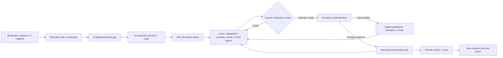

# StudyFellow — idea sketch

**Purpose:** Put the intended product experience into a visual and interaction sketch before changing the app. This sketch is based on the owner's direction and `PROJECT_BRIEF.md`; it is not an AI-generated capstone idea. Photosynthesis remains one prepared demo scenario among several.

## Amplified product prompt

> Design StudyFellow as an AI teaching fellow for professionals and secondary-school, college, and university learners who are stuck on a specific concept or topic. Prioritize the one-off learning session. The learner supplies a topic, question, or learning material and describes what is confusing in their own words. The tutor diagnoses the likely gap, proposes the learning outcome and a short multi-step route, and lets the learner correct the interpretation without making them design their own lesson.
>
> Each route is assembled from small learning steps. A step may be a plain-language explanation, a worked example, a generated or pre-prepared diagram, a quick learner response, a lesson, or a transfer check. The tutor responds to what the learner says. The learner can ask a clarifying question at any point and remain on the current step until ready. The tutor changes the explanation or route when the diagnosis or answer calls for it, then moves on when there is enough evidence to do so.
>
> For a reliable hackathon demonstration, prepare several scenario packages in advance, beginning with photosynthesis. Each package should contain a learner profile, initial diagnosis, inferred learning goal, planned steps, tutor messages, expected learner turns, response branches, source references, and explanatory image/diagram assets. Play these as realistic tutor simulations and save every turn as labeled demo data. Make it clear when a conversation turn is seeded demo data and when a response is live. The product experience should feel like a tutor composing a useful lesson, not a static questionnaire or a fixed slide deck.
>
> Start visually from a product sketch before implementing UI. Use the sketch to agree on hierarchy, spacing, card composition, tutor/learner presence, progress treatment, and how text and diagrams share the canvas. The sketch should be refined from the owner's visual feedback before polishing the implementation. Keep recurring study plans as a later session type; the first proof is a useful one-off session.

## Product idea in one sentence

StudyFellow starts a one-on-one tutor chat, asks enough to understand the learner's confusion, creates a study plan, and teaches interactively through Markdown and structured UI blocks, with plan content prepared ahead of use.

## Owner refinement — 14 October 2026

The conversation begins before the plan exists. Keep the initial topic question, diagnostic follow-ups, generated plan, and lessons in one chronological session with one bottom composer. The plan is a tutor response, not a separate setup screen. “Your turn” is a sequential activity within that conversation.

```text
StudyFellow

Tutor: What would you like to understand today?
You:   Photosynthesis. How does sunlight become food?
Tutor: What do you think the plant uses to build sugar?
       [Water and CO₂] [Sunlight] [I'm not sure]
You:   Sunlight?
Tutor: Let's work through energy and materials first.
       [Your plan: the idea → an example → apply it]
       [Let's start] [Change the focus]

       [First teaching turn: Markdown + labeled diagram]
       [Later plan content prepares in the background]

       [Continue] [Show an example]
       [Message your tutor…                         Send]
```

The response structure selects supported components and their content; the app owns layout and behavior. Eager loading prepares the plan's content without displaying all steps at once. See FR-2a and FR-2b in the product spec for the proposed contract and loading behavior. This is the intended experience; live AI diagnosis and generation are not yet implemented.

## Overall learning loop



## First screen sketch: one-off tutor session

```text
┌───────────────────────────────────────────────────────────────┐
│ StudyFellow                         ONE-OFF SESSION   1 / 4    │
│                                                               │
│  ┌─ TODAY'S LEARNING ROUTE ────────┐   ┌─ WITH YOUR TUTOR ──┐ │
│  │ ● Understand the core idea       │   │ I’ll help you work │ │
│  │ ○ See it in an example           │   │ through this step. │ │
│  │ ○ Try it yourself                │   │ Ask me to clarify  │ │
│  │ ○ Check what you can apply       │   │ anything before we │ │
│  └──────────────────────────────────┘   │ move on.           │ │
│                                         └────────────────────┘ │
│  ┌─ STEP 1 · THE IDEA ──────────────────────────────────────┐ │
│  │ [Short, readable explanation tailored to the diagnosis]   │ │
│  │                                                           │ │
│  │       [Explanatory diagram or generated visual]           │ │
│  │                                                           │ │
│  │ Source: OpenStax Biology 2e · View passage                │ │
│  └───────────────────────────────────────────────────────────┘ │
│                                                               │
│  [Ask a question…                                 Send ↗]     │
│                                                               │
│  [That makes sense] [Show another example] [I’m not sure]     │
│                                                               │
│  The tutor advances when you choose to continue or your answer │
│  shows enough—not just because a timer or page has ended.      │
└───────────────────────────────────────────────────────────────┘
```

This is a composition sketch, not a pixel-perfect visual specification. The visible route is a compact map, while the current step is the main canvas. The learner can ask inline; it should not feel like leaving a lesson to open a separate chat. Images should explain the idea and sit with the step they support.

## Scenario simulation model

Each prepared scenario is a small, versioned package that can be replayed consistently:

```text
Scenario
  learner context and level
  topic + learner's initial confusion
  diagnosis hypotheses and chosen misconception
  tutor-inferred outcome (editable by learner)
  ordered step plan, with optional branches
  source passages and claims supported by them
  text, worked examples, prompts, and expected learner turns
  clarifying-question turns and tutor responses
  feedback branches and advancement conditions
  explanatory image/diagram files and their alt text
  transfer question, assessment rubric, recap, and next action
  complete seeded transcript with demo-data provenance
```

For every scenario, run at least one complete simulated conversation from diagnosis through recap. Save the learner and tutor turns as explicit examples, including a clarification detour and a misunderstanding branch. Scenarios may be authored as structured data and rendered by the same UI, so the demo can show different topics without pretending that live model generation or a general lesson engine already exists.

## Visual direction to validate

- **Dynamic composition:** A one-on-one conversation whose tutor turns can contain explanations, diagrams, worked examples, questions, and recap cards. Structured teaching content belongs inside the conversation and preserves its chronology.
- **Tutor presence:** Calm and capable, with a clear tutor voice. Do not force a human avatar; let typography, structured cards, and focused diagrams convey teaching presence.
- **Route visibility:** Show what the AI plans to cover and where the learner is, but keep the list compact and allow it to change as the tutor learns more.
- **Learner control:** Let the learner ask, request another explanation, say they are unsure, or move on. The system proposes the destination; the learner can correct it.
- **Visual specificity:** Sketch key screens and content states before coding. Gather the owner's feedback on a concrete sketch—composition, color, density, illustration style, and interaction feel—then refine the sketch. Do not infer visual taste solely from the written brief.
- **Trust:** Put source references close to factual teaching and label authored examples or generated illustrations. Keep essential information available in text and useful on a phone.

## Scenario set for the demo

Begin with the owner-selected photosynthesis scenario. Add other scenarios only when there is a credible source, a clear misconception, a short diagnosis, and a distinct transfer check. Existing discovery signals include virtual-assistant learners needing help catching up after absence and a university educational-technology contact naming instructional design; these are leads for scenario research, not proof that these scenarios are validated or ready to teach.

## Sketch-to-build workflow

1. Start from the amplified prompt and this low-fidelity layout.
2. Owner describes visual refinements in text or shares a hand sketch; translate that into a revised annotated sketch.
3. Agree on the hierarchy and interaction states before coding the visual treatment.
4. Build one scenario end to end, with prepared tutor turns and diagram assets.
5. Replay alternative learner responses to show that the route and explanation change.
6. Only then expand the scenario library or explore recurring sessions.
