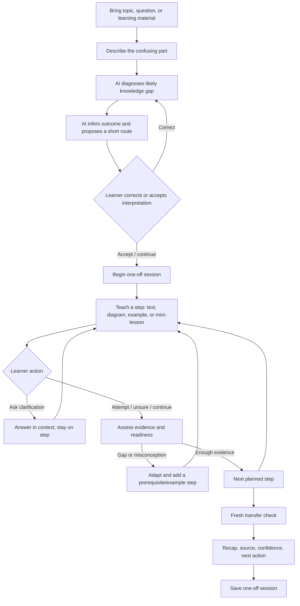

# StudyFellow — product and demo specification

**Status:** Product specification for review and implementation planning. Based on the owner-provided idea, `PROJECT_BRIEF.md`, and `outputs/studyfellow-idea-sketch.md`. This reframes the intended interaction; it does not claim that the current app already implements AI-generated lesson planning or live multimodal generation.

## 1. Product definition

StudyFellow is an AI teaching fellow for professional learners and secondary-school, college, and university students who are stuck on a specific concept or topic. A learner brings the material and explains the confusion. StudyFellow diagnoses the likely learning gap, sets a suitable learning outcome, plans a short sequence of teaching steps, and adapts those steps to the learner's responses.

The product should feel like a one-on-one chat with an AI tutor. The conversation is the primary surface from initial diagnosis through plan, teaching, practice, and recap. Tutor turns combine Markdown with structured teaching and interaction blocks composed around the learner.

### Product promise

**Bring the part that is confusing. StudyFellow will work out what to teach next, explain it in useful ways, answer questions along the way, and check what you can apply.**

### Hackathon proof

Demonstrate the promise through a set of prepared, replayable scenarios, beginning with the owner-selected photosynthesis lesson. Each scenario should show the tutor infer a goal, plan multiple steps, teach through text plus an explanatory visual, respond to a learner turn or clarification, and select the next useful step. The scenarios demonstrate the intended dynamic interaction; they are seeded demo data, not proof of general live AI generation.

## 2. Intended learners and other roles

- **Learners:** Professionals and secondary-school, college, and university learners with a specific concept/topic blocker.
- **Potential adopters or payers:** Learners themselves, and institutions such as schools, academies, colleges, and universities. The first segment and buying path remain hypotheses.
- **Tutor system:** Interprets the learner's context, identifies a likely blocker, proposes a learning outcome, plans and adapts teaching steps, and assesses evidence conservatively.
- **Content reviewer:** Checks source quality, factual claims, learning level, diagrams, prompts, and answer criteria for each prepared scenario.

Do not assume one reading level, curriculum, language, device, or prior knowledge across this audience. The first demo is English, phone-friendly, and content-specific.

## 3. Core interaction principles

**Owner language direction, 14 October 2026:** Treat StudyFellow as a real product. Use short, familiar words and simple controls. Do not describe the app as a “demo” on learner screens. Explain current limits plainly where they affect an action, and keep example answers distinct from learner answers. Engineering and presentation records can still describe how the system works and which behavior is simulated. This replaces earlier instructions to use demo badges in the app.

**Owner clarification, 14 October 2026:** Start inside the one-on-one tutor conversation. The tutor asks initial diagnostic questions, then generates a study plan and conducts an interactive session based on it. Responses contain Markdown plus structured data defining the UI. Prepare plan content eagerly, while revealing it progressively. This supersedes a separate setup-first experience; existing Phase 1 routes remain implementation history, not the target entry flow. “Your turn” remains a sequential conversational activity, using the same composer.

1. **The tutor owns instructional planning.** The learner supplies a topic/resource and confusion. The AI infers a learning outcome and plan; the learner can correct the interpretation. Do not require learners to define a learning objective before receiving help.
2. **Diagnosis is lightweight and conversational.** Ask only what is needed to distinguish likely gaps. Offer an unsure/skip route and do not block help on a diagnostic.
3. **The lesson is conversational, step-based and interruptible.** A step can be an explanation, example, prepared image/diagram, learner prompt, or short mini-lesson. One session chat input supports bidirectional communication: learner questions, reactions and other feedback receive contextual replies without requiring an explicit question. Teaching and “Your turn” checks appear sequentially, not as simultaneous forms.
4. **The tutor advances with evidence and learner readiness.** Use learner attempts and explicit continuation; do not auto-advance merely because a page or timer ended.
5. **The route can change.** If an answer reveals a prerequisite gap or misunderstanding, add or substitute a teaching step. If the learner demonstrates understanding, skip redundant practice and move forward.
6. **Trust is visible.** Place sources near factual teaching. Distinguish source-backed claims from authored analogies, seeded demo responses, and generated illustrations. Show uncertainty and request clarification when an answer is ambiguous.
7. **The interaction is multimodal but text-complete.** Images should explain relationships, processes, or spatial structure; provide concise alt text and a text equivalent. The first MVP supports text and static/pre-generated explanatory diagrams.

## 4. Session-type model

The product can support one-off help and recurring planned study. The tutor may infer which mode fits the learner's request, but the learner must understand and be able to change that choice.

### MVP: one-off session

- Default to a one-off session when the learner brings an immediate question or topic blocker.
- If the learner describes an ongoing goal, the tutor may recommend a recurring plan, but the first demo still begins with a one-off session and explains how continuation could work later.
- Do not ask the learner to select a schedule before helping.

### Later: recurring plan

- Use explicit consent before creating a schedule or reminders.
- Carry forward learner-approved progress, goals, and sources.
- At a return session, diagnose what changed and offer a short catch-up instead of assuming the previous plan remains suitable.

## 5. Target learner journey



## 6. Functional requirements

### FR-1: Learner input and diagnosis

- Open with a tutor message such as “What would you like to understand today?” in the session conversation. Topic, confusion, and diagnostic answers are learner turns in that same conversation, rather than a separate setup questionnaire.
- Accept a topic/question in the learner's words and, for the MVP, an optional short description of what is confusing.
- Later, allow material input/attachments; MVP uses a prepared sample or typed topic and does not claim general document ingestion.
- Use diagnosis to identify a likely gap or misconception and mark uncertainty where diagnosis is ambiguous.
- Ask at most one focused follow-up at a time. Provide a skip/unsure option that still starts useful teaching.
- Use the learner's topic and answers to choose relevant follow-ups about prior understanding, context, or available time; do not ask a fixed list when the information is already known. Explain a tentative starting point if diagnosis is skipped.

### FR-2: AI-inferred goal and plan

- Generate a plain-language learning outcome from the diagnosis, rather than requiring the learner to set one.
- Build an ordered, short session plan with varied step types and a transfer check.
- Present a compact plan preview (for example, “Understand the idea → see it in an example → try it → apply it”).
- Let the learner correct the topic interpretation or outcome. Do not turn this into a setup wizard.
- Keep an internal rationale/source link for each step and define what learner evidence permits advancement.
- Present the plan as a tutor turn with an interactive plan block. The learner can correct it or begin through the same conversation; the plan remains accessible as a compact progress reference.

### FR-2a: Eager preparation of plan content

- Once a plan is accepted, begin preparing and caching content for every planned step, including explanations, examples, prompts, source references, and required static assets. Load eagerly; display one useful turn/activity at a time.
- Let the first lesson begin as soon as its essential text is ready. Later steps and assets may finish in the background; do not hold the whole session behind the slowest image.
- Track each step as pending, loading, ready, or failed. Preserve the conversation on failure and offer retry or a text equivalent for missing visuals.
- Associate content with a session, plan revision, and step ID. When adaptation changes a step, invalidate its obsolete content and prepare the replacement; late results for an older revision must not overwrite the active plan.
- Use a bounded preparation queue for a short one-off plan. Do not eagerly generate an unbounded course or every hypothetical branch. Prepare a new detour when it becomes relevant.
- For the hackathon runner, loading a complete authored scenario package satisfies content preparation. Runtime AI generation remains separate future work; a prepared package does not establish live model capability or offline AI.

### FR-2b: Structured tutor response and UI renderer

- Each tutor response is a versioned structured envelope containing conversational Markdown, ordered UI blocks, optional plan changes, and allowed learner actions. Diagnosis, plan, and teaching use the same response contract.
- The application maps an allowlisted block type to a known React component. The tutor chooses content, order, and supported interactions; it does not return executable UI code or arbitrary page layouts.
- Initial block types: diagnostic question with optional choices, study plan, explanation, diagram/image, worked example, practice question, feedback, and recap. Markdown can appear within a block; avoid duplicating the same explanation in both the message and a block.
- Validate responses before rendering. Keep a readable text fallback for unsupported/invalid blocks, sanitize Markdown, and support accessible labels, text equivalents, and source references.
- Action IDs represent defined app operations such as answer diagnosis, accept/correct plan, request an example, submit practice, or continue. A clarification reply stays on the current step unless learner evidence and readiness justify a visible plan transition.

Illustrative target envelope (a contract proposal, not the current runtime schema):

```json
{
  "schemaVersion": 1,
  "turnId": "tutor-03",
  "sessionId": "session-01",
  "phase": "planning",
  "markdown": "We'll focus on **how light helps a plant make sugar**.",
  "planRevision": 1,
  "blocks": [{ "id": "plan-preview", "type": "study-plan", "planId": "plan-01" }],
  "plan": {
    "id": "plan-01",
    "outcome": "Explain how light energy helps sugar production.",
    "steps": [
      { "id": "core", "title": "Understand the idea", "kind": "explanation" },
      { "id": "example", "title": "See an example", "kind": "worked-example" },
      { "id": "transfer", "title": "Apply it", "kind": "practice-question" }
    ]
  },
  "actions": [{ "id": "accept-plan", "label": "Let's start" }]
}
```

### FR-3: Dynamic learning step

- Render a step using an appropriate content block: explanation, diagram/image, example, learner prompt, mini-lesson, or recap.
- Keep learner messages in context through one generic session composer. Questions, statements such as “I still don’t understand,” and other feedback are conversational during teaching; no dedicated question field or intent selector is required. Replies preserve the current content, stored check draft and place in the plan.
- Show chronological learner/tutor turns with structured text/diagram teaching. Reveal “Your turn” as a separate check step only when the learner explicitly continues, using the same composer. Do not show teaching, answer form and future checks all at once.
- Support requests for another example, uncertainty and explicit continuation through the session conversation. In a check, help feedback remains conversational and unknown wording cannot silently become a successful assessed answer.
- Show the current step and compact route progress, with any tutor-added step visible as an adaptation.
- Anchor the session composer at the bottom, with relevant actions above and Send inline with a textarea that grows as the learner types. Keep teaching/conversation in a separate scrollable region; response-dependent content stays in chronological position. Reserve composer space so content is not covered, including on phones.

### FR-4: Adaptive transitions

- Classify an answer conservatively as demonstrated, partially demonstrated, misconception, or unclear.
- Connect feedback to what the learner actually said; do not praise incorrect reasoning as correct.
- For a gap, choose a targeted re-explanation, example, or prerequisite micro-lesson and then check again with a different prompt.
- For demonstrated understanding, allow the tutor to skip redundant explanations while retaining the planned learning outcome.
- Keep the first-attempt evidence separately from retries.

### FR-5: Multimodal teaching content

- MVP response formats: text plus an explanatory still image/diagram where it adds instructional value.
- Each image has descriptive alt text, source/creator provenance, and a short textual explanation.
- Prepare images before the demo and associate each with specific scenario steps; do not block the core path on image generation or a network call.
- Later: on-demand image generation, audio/voice, video, and broader modality selection after quality and cost are understood.

### FR-6: Session close and return

- End with a concise recap, evidence demonstrated, unresolved point, source(s), and one next action.
- Save one-off progress locally in the MVP with an accurate saved/not-saved indicator.
- Recurring schedules, notifications, accounts, and cross-device sync are later work.

## 7. Scenario data and conversation simulations

### Scenario package schema

Each demo scenario should be saved in a structured form rather than embedded as one hard-coded screen. Minimum fields:

```text
id, version, title, learnerType, educationOrWorkContext, language
topic, sourceMaterials[], initialLearnerInput
diagnosis { likelyGap, evidence, confidence, alternatives[] }
inferredOutcome, sessionTypeRecommendation
steps[] { id, kind, objective, sourceRefs[], contentBlocks[],
          learnerPrompt?, advanceCriteria?, branches[] }
assets[] { id, path, type, altText, caption, provenance, sourceRef? }
simulationPaths[] { pathId, learnerProfile, turnSequence[] }
transferCheck { prompt, rubric, expectedEvidence, feedbackBranches[] }
recap, nextAction, demoProvenance
```

`turnSequence` stores ordered speaker/content records. Every seeded learner turn must be labeled as simulated. Store the tutor response, selected branch, referenced assets, rationale for the next step, and assessment result. Keep these records immutable during playback; learner-entered live demo text may be stored separately from canonical seeded data.

### Scenario authoring and rehearsal requirements

For each selected scenario:

1. Identify a specific learner type and a real learning context.
2. Select credible sources and have a competent reviewer check key teaching claims.
3. Define an initial input, likely diagnosis, inferred outcome, and a multi-step plan.
4. Write at least three simulated learner paths: correct/ready, partial or misconception, and clarification question before continuing.
5. Author tutor turns and branches, including any added mini-lesson or changed step order.
6. Create or select explanatory still images/diagrams for the plan; add alt text and provenance.
7. Define a fresh transfer check and scoring criteria.
8. Save the complete exchanges as versioned demo data and rehearse each path in the app.

### Initial scenario inventory

| Scenario | Learner context | Readiness |
|---|---|---|
| Photosynthesis: light energy and sugar production | Secondary-school biology | Existing owner-selected scenario; source-backed spec exists; prepare diagrams and conversation paths |
| Instructional design: applying a design model to a learning need | University educational technology | Contact mentioned this topic; research and permission/context validation needed before authoring as instruction |
| Virtual-assistant study catch-up | Secondary/university virtual-assistant learners | Group contact flagged catching up after absence; elicit a concrete concept from responses before choosing a lesson |

Do not imply the latter two are validated lessons simply because they appeared in discovery contacts. Scenario breadth is less important than credible, distinct adaptive paths.

## 8. Visual and interaction direction

- Use [the idea sketch](studyfellow-idea-sketch.md) as the first layout reference, not a mandate for exact styling.
- Main hierarchy: app identity → chronological one-on-one conversation with structured tutor content → relevant response actions → bottom composer. After diagnosis, keep a compact plan/progress reference accessible without displacing the conversation.
- The learning canvas changes shape by step type; do not render every step as the same chat bubble/card.
- Avoid dense timelines, dashboard analytics, lengthy onboarding, or user-authored objective forms in the one-off flow.
- The current cosmic visual identity can remain a starting point, but the owner has said prior visuals have not matched their taste. Treat illustration style, density, color balance, and tutor presence as open decisions to validate against a concrete revised sketch before polishing.
- Keep the layout mobile-first and ensure the current explanation, image, source, and response control remain easy to scan.

## 9. MVP boundary

### Must demonstrate

- A coherent one-off session from learner input to evidence-based recap.
- AI-inferred (or precomputed scenario-inferred for the deterministic demo) outcome and multi-step plan.
- Multiple step types, including explanation, a prepared explanatory diagram, learner response, and transfer check.
- A learner clarification turn that is answered without leaving or losing the current step.
- At least one response branch that adapts the explanation/plan based on learner input.
- Several prepared scenario packages, beginning with photosynthesis, with recorded simulation turns and clear demo-data provenance.
- Source attribution, image alt text, transparent assessment criteria, and save/resume of the demo session.

### Explicitly later

- Live general-purpose model generation across arbitrary topics.
- Automatic image generation during each live lesson; the MVP can use scenario-prepared assets.
- Broad uploads, source retrieval at scale, institutional dashboards, accounts, collaboration, multilingual model evaluation, recurring schedules, reminders, voice/video, and long-term mastery analytics.

This boundary protects the dynamic feel without falsely presenting a deterministic hackathon scenario runner as a production tutor. If time forces a smaller implementation, preserve the visible plan, multi-format step, clarification loop, adaptive branch, and transfer check; defer scenario count first.

## 10. Quality, privacy, and inclusion constraints

- Verify factual teaching claims and trace them to credible sources; keep citations available from the step.
- Use examples appropriate to the learner context and label simplified or conditional claims.
- Keep essential content in text; provide alt text and avoid color-only meaning.
- Provide a route through diagnostic skips, unclear answers, and requests for another explanation.
- Minimize data. The demo does not need learner names, school identifiers, or contact details.
- Do not claim AI/offline capability, supported language quality, or durable learning from seeded demo paths.
- Show whether content is source-based, authored, generated, or simulated.

## 11. Acceptance criteria

1. A new learner can enter a topic and describe a confusion without filling in a learning-goal field.
2. The tutor presents a plausible inferred outcome and ordered route that the learner can correct.
3. The demo can replay at least three distinct learner paths for a scenario, including a clarification detour and a misunderstanding branch.
4. A prepared diagram appears at the right teaching step with alt text and visible provenance/source where applicable.
5. Asking a clarification question preserves the step and any draft response; the learner explicitly continues afterward.
6. A misunderstanding changes the tutor's next teaching step and a new check is used afterward.
7. The completed session shows a fresh-transfer result, honest evidence/uncertainty, cited source, recap, and a next action.
8. A seeded conversation is visibly identified as a simulation; it cannot be mistaken for an actual learner result or live model output.
9. The primary flow works on a phone viewport, with a text equivalent for all important image content.
10. The existing photosynthesis scenario's biology specification remains the source of truth for its content and scoring unless a qualified review changes it.
11. Diagnosis, plan preview, and teaching occur in one tutor conversation, retaining earlier turns and using one composer.
12. Validated tutor envelopes render Markdown and supported interactive blocks; unsupported content has a readable fallback.
13. Accepting a plan starts eager preparation of its content. The first ready step is usable while later steps load; failed assets and obsolete plan revisions cannot block or replace the active conversation.

## 12. Success signals and open questions

**Demo success:** A judge can see that the tutor planned a route from a learner's confusion, that the learning surface changes by step, that the learner can interrupt to ask, and that the plan responds to learner evidence before checking transfer.

**Pilot signals:** Completion of the one-off session, clarification usage, answer quality on a fresh transfer task, comprehension of tutor feedback, and whether the learner would return. Seeded paths show interface behavior but do not count as learner research.

**Open decisions:** Which visual style best matches the owner's taste; how many scenarios can be properly sourced and authored; which learner type to recruit for the first live usability check; when to ask a learner to confirm an inferred goal; and how source-grounded dynamic content will be implemented after the deterministic scenario demo.

## 13. Project alignment

- **Project brief:** `PROJECT_BRIEF.md`
- **Product idea/layout sketch:** `outputs/studyfellow-idea-sketch.md`
- **Existing photosynthesis lesson source and rubric:** `outputs/photosynthesis-demo-spec.md`
- **Existing learner journey and FigJam reference:** `outputs/studyfellow-ux-blueprint.md`
- **Build plan:** `PROJECT_ROADMAP.md`

This product spec supersedes earlier UX wording that treated the photosynthesis lesson as the only MVP audience or presented a user-selected goal as required setup. The existing photosynthesis content and rubric remain the authoritative scenario details.
