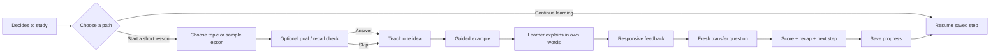
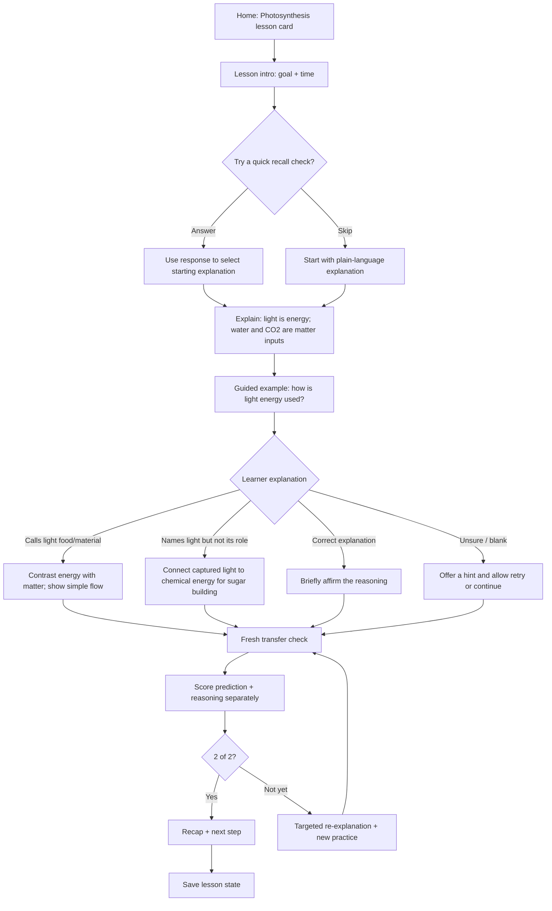
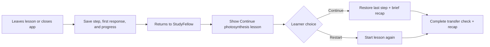

# StudyFellow UX Blueprint

**Purpose:** Small product/design reference for the hackathon MVP. StudyFellow is intended for professional learners and secondary-school, college, and university students who struggle with a specific concept or topic. The current build demonstrates one configured photosynthesis lesson; it does not narrow the product audience to biology or secondary school. Only the home screen and basic photosynthesis lesson shell currently exist in `system/study-fellow-ui/`.

## 1. Overall learner experience

The learner should be able to start without creating an account, skip personalization, get help with one concept, try a new application, and return later without losing their place.

**Experience principles**

- Make the next useful action obvious; the MVP is a short lesson, not a course setup wizard.
- Treat `I’m not sure` and skipping the diagnostic as valid choices.
- Feedback should explain the idea and invite another attempt, never shame or falsely praise an incorrect response.
- Show the source near the teaching content and the learner's progress near the lesson.
- On return, say what the learner last worked on and let them continue or restart.

## 2. Focused MVP flow: photosynthesis demo scenario

This is one seed lesson used to demonstrate the reusable flow (topic → explain → learner reasoning → responsive feedback → transfer check → next step). Other subjects, learner levels, and professional topics are future content configurations, not current app capabilities.

### Photosynthesis content and response logic

1. **Goal:** Explain how light energy contributes to sugar production in photosynthesis.
2. **Optional diagnostic:** “Which are materials the plant uses: water, carbon dioxide, or light energy?” Skipping goes straight to the explanation; no learner is blocked.
3. **Teach:** `light captured by chlorophyll → energy stored in chemical carriers → energy helps build sugar from CO₂`; water participates and oxygen is released. Keep the OpenStax attribution visible.
4. **Guided question:** “What role does the light play?” Accept a short typed response, an `I’m not sure` option, or a retry after a hint.
5. **Incorrect or incomplete response:**
   - If light is described as food/material, distinguish energy from matter inputs.
   - If light is recognized as energy but not linked to sugar, explain that captured light energy is converted into chemical energy used in sugar-building reactions.
   - If the learner is unsure, provide a one-sentence hint and a simpler choice/analogy before asking again.
   - Keep the original response for the demo trace; do not label a retry as the first-attempt result.
6. **Fresh transfer check:** “Two similar plants have the same water, carbon dioxide, and temperature. Plant B is moved to much dimmer light, and light is now the limiting factor. Which plant makes sugar faster? Explain why.”
7. **Scoring:** 1 point for predicting Plant A has a higher sugar-production rate; 1 point for connecting less light to less captured energy available for sugar building. Success is 2/2 on the first transfer attempt; record retries separately.
8. **Close:** Show the answer evidence, source link, a short recap, and one manageable next step. Save the current step and result locally for resumption in the prototype.

This is a school-level simplification. State that the comparison assumes light is limiting and other conditions are held suitable; do not imply that total stored glucose can be predicted from light alone. OpenStax Biology 2e is the reference, pending a biology reviewer: [8.1 Overview of Photosynthesis](https://openstax.org/books/biology-2e/pages/8-1-overview-of-photosynthesis) and [8.2 Light-Dependent Reactions](https://openstax.org/books/biology-2e/pages/8-2-the-light-dependent-reactions-of-photosynthesis).

## 3. Return / interruption flow

**MVP behavior:** Use local persistence for this single demo lesson; no account, cloud sync, reminder delivery, or cross-device state is required. If persistence is unavailable, show a clear `Start again` action rather than implying progress was saved.

## 4. Reference document

### Intended learner and demo persona

- **Intended learners:** Professionals and secondary-school, college, and university learners who need help with a specific concept or topic. The product should start from the learner’s context or material rather than assume a single course or level.
- **Demo persona:** Secondary-school biology learner studying photosynthesis. This configured test case does not establish the primary market segment; its curriculum fit, reachability, and difficulty prevalence still need validation.
- **Potential adopters/payers:** Learners may adopt and pay individually; schools, academies, colleges, and universities may adopt or pay institutionally. The first segment and buying path are unvalidated.
- **Market direction:** Africa, starting with Nigeria.
- **Access assumptions:** Phone-first, text-first, potentially limited data, mixed confidence, and optional diagnostic. English is the prototype language; do not imply multilingual or offline AI support.

### Learner goals

- Understand the roles of light energy, water, and carbon dioxide in photosynthesis.
- Explain, not merely recall, why less light can lower sugar-production rate when light is limiting.
- Practise a fresh application and know whether the reasoning was complete.
- Leave with a useful recap and return to the lesson later.

### Content structure

`lesson goal → optional recall → sourced explanation → worked/guided example → learner response → tailored feedback → transfer check → result/recap → next step and saved state`.

Keep each screen focused on one decision or idea. Use concise paragraphs, readable equations, plain-language labels (`energy` vs `matter`), and visible source attribution. Avoid long setup forms and ungrounded claims.

### Navigation model

- **Home (`/`):** One featured `Continue learning` lesson card; if there is no saved session, the same card starts the lesson. A secondary `How it works` affordance may explain the teaching loop.
- **Lesson (`/lesson`):** A focused, step-based flow with progress, `Back`, `Continue`, `I’m not sure`, and `Save and leave` actions. Keep the source accessible without losing the learner's place.
- **Recap:** End state of the lesson flow (may be a screen/state rather than a separate route): first-attempt score, what the learner showed, what to revisit, source, and next action.
- Keep navigation shallow for the demo; no timetable, course catalogue, profile, or settings section is needed.

### Assumptions and validation questions

- The photosynthesis concept is useful to the selected learners; validate with a secondary-school learner or biology teacher.
- Learners can type a short explanation on their device; offer `I’m not sure` and retry to avoid a text-literacy dead end.
- Local browser storage is acceptable for a non-sensitive demo result. Collect no name, school, or contact details.
- Test whether learners understand the feedback and can answer the fresh question; a seeded demo response is not user evidence.
- Test a phone-sized viewport and a slow/failed connection. Cache static shell and lesson content only if feasible; do not claim AI tutoring works offline.

### MVP versus later

| MVP for this hackathon | Later, if evidence supports it |
|---|---|
| Reusable topic-learning flow demonstrated with one photosynthesis lesson for secondary-school biology | Content configurations for multiple subjects, curricula, professional topics, and learner levels |
| Optional recall check with skip | Adaptive diagnostics across a course |
| Three response-sensitive feedback branches | Open-ended AI tutoring with broader evaluation and safeguards |
| Fresh transfer question with a transparent 2-point rubric | Longitudinal mastery and retention tracking |
| Source link, plain-language text, mobile-first layout | Curriculum integrations and teacher dashboards |
| Local save/resume for one lesson; no account | Cross-device sync, reminders, course schedules |
| English and deterministic demo fallback | Reviewed multilingual support, audio, richer media |
| Nigeria is the market starting direction; no claims about market size | Multi-country rollout, validated distribution and revenue model |

## 5. Build status

The current React app in `system/study-fellow-ui/` has a home screen and a basic photosynthesis lesson shell. The optional diagnostic/skip path, distinct misconception branches, scored fresh-transfer question, recap, and reliable save/resume described here remain to be implemented. Photosynthesis is currently static demo content rather than a configurable multi-subject engine. See `PROJECT_ROADMAP.md` for build status.

## 6. Diagram source and FigJam reference

- **Diagram evidence:** [StudyFellow Learner Journey in FigJam](https://www.figma.com/board/nNSLHPTQzZQnursYfJywjL/StudyFellow-Learner-Journey?t=Dz4LlGpQs0owQUeX-6) (owner-provided link, 13 October 2026).
- **Text reference:** The Mermaid sketches embedded above preserve the flow details alongside the UX decisions and MVP scope. Use the FigJam board as the visual companion and this document as the written product reference.
